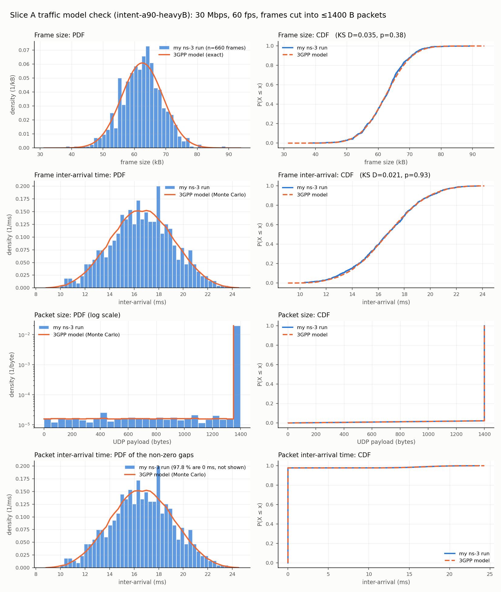

# Run `intent-a90-heavyB`

## Traffic model check (slice A)

| Quantity | Samples | My mean | 3GPP model mean | KS test |
| --- | --- | --- | --- | --- |
| Frame size (B) | 660 | 62333 | 62500 | D=0.035, p=0.38 |
| Frame jitter (ms) | 660 | -0.00 | 0.00 | D=0.018, p=0.98 |
| Frame inter-arrival (ms) | 658 | 16.66 | 16.67 | D=0.021, p=0.93 (two-sample) |
| Packet size (B) | 29715 | 1384 | 1385 | n/a |
| Packet inter-arrival (ms) | 29713 | 0.369 | 0.369 | n/a |

p > 0.05: no evidence that my generator differs from the model.

## Per-slice KPIs (FlowMonitor)

| Slice | Flows | Throughput (Mbps) | Mean delay (ms) | p95 delay (ms) | Loss (%) |
| --- | --- | --- | --- | --- | --- |
| A | 2 | 61.23 | 1.758 | 3.00 | 0.00 |
| B | 2 | 37.03 | 7.229 | 12.70 | 9.99 |

## Slice B SLA

- p95 delay 12.70 ms vs target 10 ms: VIOLATED
- loss 9.99 % vs target 1 %: VIOLATED
- **Verdict: SLA violated** (intent `a90-heavyB` was accepted by the capacity-only check)
