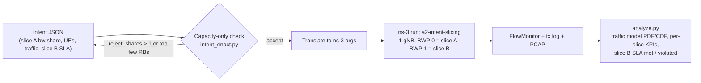
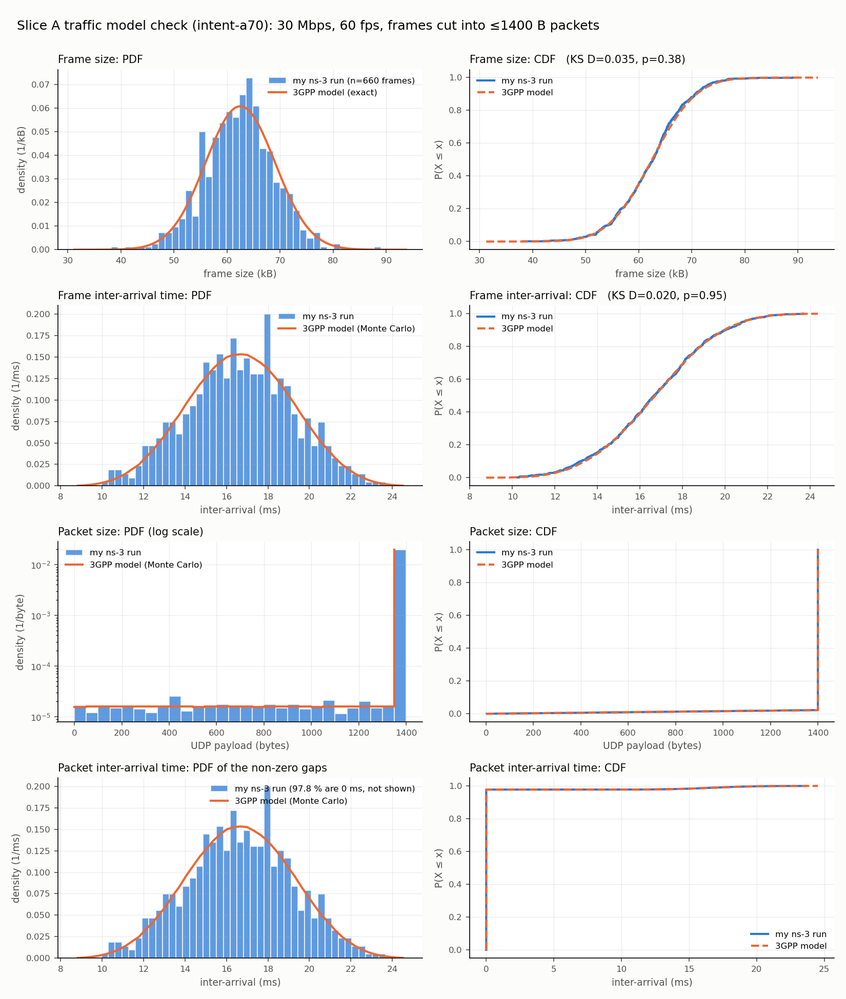
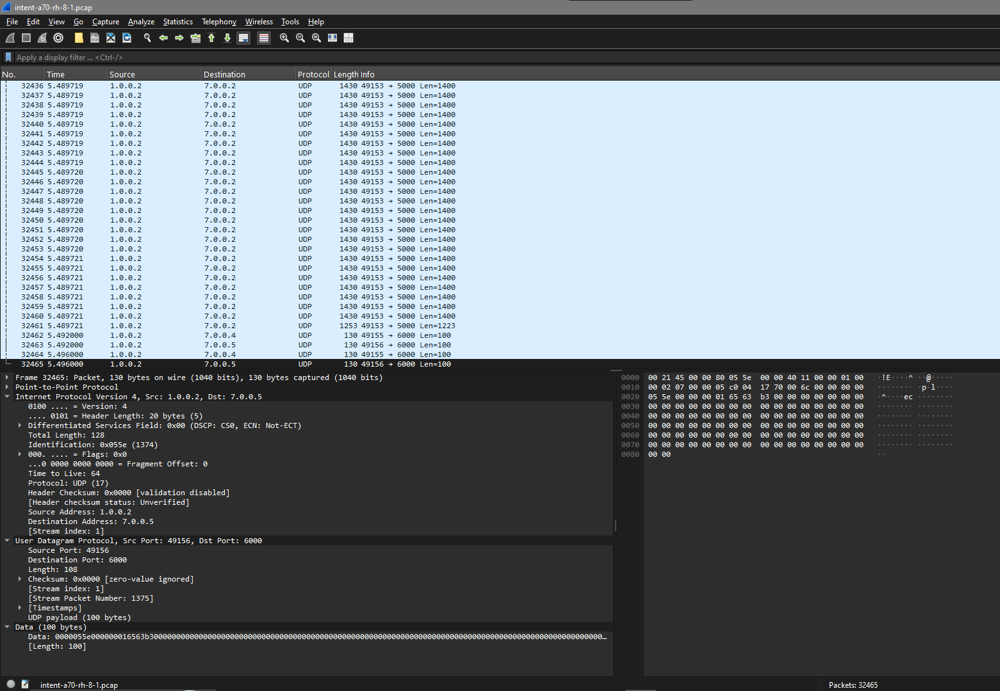
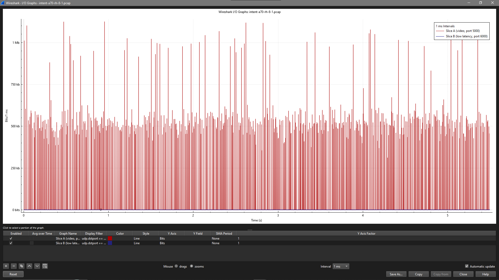

# A2: ns-3 Setup & Traffic Model

**Course:** Multimedia Wireless Networks (ET5907701), Fall 2026 · **Student:** Petrajoy Davidson (M11502803) · **Path:** Advanced · **Presentation:** Week 7, 10 minutes

**One-line take-away:** ns-3.48 + 5G-LENA v5.1 runs on my lab VM, and my first scenario is already the testbed of my project: a slice intent sets the bandwidth of two NR slices, slice A carries 3GPP XR video that I generate and verify against the model, and FlowMonitor tells whether slice B still meets its SLA.

## Table of Contents

1. [Setup](#1-setup)
   - [1.1 Platform and versions](#11-platform-and-versions)
   - [1.2 Install steps](#12-install-steps)
   - [1.3 What broke](#13-what-broke)
2. [Traffic Model (3GPP TR 26.926)](#2-traffic-model-3gpp-tr-26926)
   - [2.1 The model](#21-the-model)
   - [2.2 Built-in or my own?](#22-built-in-or-my-own)
3. [First Scenario: Intent-Driven Two-Slice NR](#3-first-scenario-intent-driven-two-slice-nr)
4. [Source Code and Run Commands](#4-source-code-and-run-commands)
5. [Results From My Run](#5-results-from-my-run)
   - [5.1 Traffic model verification (PDF / CDF)](#51-traffic-model-verification-pdf--cdf)
   - [5.2 Per-slice KPIs](#52-per-slice-kpis)
   - [5.3 PCAP in Wireshark](#53-pcap-in-wireshark)
6. [Link to My Project](#6-link-to-my-project)
7. [References](#7-references)

## 1. Setup

### 1.1 Platform and versions

| Item | Value |
| --- | --- |
| Machine | Lab VM `joy` (8 vCPU, 16 GiB RAM, ~500 GB disk), shared with my O2/k8s lab work |
| OS | Ubuntu 22.04.4 LTS, kernel 5.15.0-190-generic |
| ns-3 | `ns-3.48` (tag) |
| NR module | 5G-LENA `5g-lena-v5.1.y` (branch), the release paired with ns-3.48 |
| Compiler | g++ 11.4 (ns-3.48 needs g++ ≥ 11.1) |
| CMake | 3.31.6 from pip, user-level (system CMake 3.22.1 is too old, see 1.3) |
| Python | 3.10 (ns-3.48 needs ≥ 3.10) |
| Build | `default` profile (debug + optimisation), examples and tests on, `-j4` |
| Build time | 53 min 28 s wall clock for 2 389 targets (`-j4`, niced, VM shared with k8s); my scenario then compiled first time |

**Why the VM and not my laptop:** the laptop is Windows without WSL. ns-3 is developed and tested on Linux, the VM already runs Ubuntu 22.04 with 8 cores, and it is the same machine I use for the O-RAN lab, so the project and the simulator live in one place.

### 1.2 Install steps

Run as the normal user (`joy`), inside `tmux` so a dropped SSH session does not stop the build.

```bash
# dependencies (as root)
apt-get install -y g++ cmake ninja-build ccache git pkg-config python3 python3-dev python3-pip \
  libc6-dev sqlite3 libsqlite3-dev libeigen3-dev \
  python3-numpy python3-pandas python3-matplotlib python3-scipy

# CMake >= 3.25 for ns-3.48 (as joy)
python3 -m pip install --user "cmake==3.31.6"
echo 'export PATH=$HOME/.local/bin:$PATH' >> ~/.bashrc && export PATH=$HOME/.local/bin:$PATH

# ns-3 + 5G-LENA, matching versions (README compatibility table of the nr module)
git clone https://gitlab.com/nsnam/ns-3-dev.git ~/ns-3-dev
cd ~/ns-3-dev && git checkout -b ns-3.48 ns-3.48
cd contrib && git clone https://gitlab.com/cttc-lena/nr.git
cd nr && git checkout -b 5g-lena-v5.1.y origin/5g-lena-v5.1.y

# configure and build
cd ~/ns-3-dev
./ns3 configure --enable-examples --enable-tests 2>&1 | tee ~/a2-configure.log
time nice -n 10 ./ns3 build -j4 2>&1 | tee ~/a2-build.log

# smoke test
./ns3 run hello-simulator
./ns3 run cttc-nr-demo
```

Configure result: `nr` is in "Modules configured to be built", `SQLite support : ON`, `Eigen3 support : ON`. Not built (not needed): brite, click, mpi, openflow, visualizer.

### 1.3 What broke

| # | Symptom | Cause | Fix |
| --- | --- | --- | --- |
| 1 | `Exception: Refusing to run as root` from `./ns3 configure` | I cloned and ran everything in a root shell; ns-3 refuses to build as root on purpose | `mv /root/ns-3-dev /home/joy/ && chown -R joy:joy /home/joy/ns-3-dev`, then work as `joy` |
| 2 | `CMake 3.25..3.25 or higher is required. You are running version 3.22.1` | ns-3.48 raised the CMake minimum from 3.20 to 3.25; Ubuntu 22.04 ships 3.22 | user-level CMake 3.31.6 from pip, first on `PATH`; then `rm -rf cmake-cache` and configure again. Pinned 3.x rather than CMake 4, which drops old `cmake_minimum_required` syntax |
| 3 | 5G-LENA README install commands still say `ns-3.46` / `5g-lena-v4.1.1` | README text not updated; its compatibility table is | followed the table: v5.1.y ↔ ns-3.48 |
| 4 | Wireshark shows slice A packets as protocol "TAPA", `Tunnel - V=0, T=Type 0` | UDP port 5000 is registered to the Trapeze Access Point Access protocol, so Wireshark guesses that dissector | Analyze → Enabled Protocols → untick TAPA (`tshark --disable-protocol tapa`); the packets then show as plain UDP `→ 5000 Len=1400` |

## 2. Traffic Model (3GPP TR 26.926)

The assignment names "TS 26.926", but 26.926 is a **Technical Report (TR)**: *Traffic Models and Quality Evaluation Methods for Media and XR Services in 5G Systems*. Its XR video traffic model is the one RAN1 defined for XR evaluations in TR 38.838 (Sec. 5.1.1, Table 5.1.1.1-1); 5G-LENA cites the same table.

### 2.1 The model

Single-stream DL XR / cloud video, one stream per UE:

| Parameter | Model | My default |
| --- | --- | --- |
| Frame rate $F$ | fixed | 60 fps |
| Data rate $R$ | fixed | 30 Mbps per UE |
| Frame size $S$ | truncated Gaussian, mean $\bar S = R/(8F)$, STD $0.105\,\bar S$, range $[0.5\,\bar S,\ 1.5\,\bar S]$ | mean 62 500 B, STD 6 563 B, range [31 250, 93 750] B |
| Frame jitter $J$ | truncated Gaussian, mean 0, STD 2 ms, range [−4, 4] ms | same |
| Arrival of frame $k$ | $t_k = k/F + J_k$ (jitter around a fixed grid) | same |
| Packetisation | not fixed by the model | frame cut into UDP payloads of ≤ 1400 B, sent back to back |

What this predicts, and what I check in [5.1](#51-traffic-model-verification-pdf--cdf):

- **Frame size** follows the truncated Gaussian exactly.
- **Frame inter-arrival** is $1/F + J_{k+1} - J_k$: centred on 16.67 ms, spread ±8 ms, triangular-ish because it is the difference of two jitters.
- **Packet size** is almost all 1400 B, plus one smaller "remainder" packet per frame (about 45 packets per frame).
- **Packet inter-arrival** is 0 ms for packets inside a frame (≈ 98 % of gaps) and the frame gap otherwise.

### 2.2 Built-in or my own?

5G-LENA v5.1 has a built-in generator for this model, `ns3::TrafficGenerator3gppGenericVideo` (`contrib/nr/utils/traffic-generators/model/traffic-generator-3gpp-generic-video.cc`). Reading its source, it does not match the table above:

| Point | TR 38.838 / TR 26.926 | Built-in generator (v5.1 source) |
| --- | --- | --- |
| Frame size spread | STD = 10.5 % of the mean | sets the `Variance` of the normal RV to `0.105 * mean` (line 299), so STD = √(0.105 · 62 500) ≈ 81 B instead of 6 563 B: frames are almost constant |
| Jitter spread | STD 2 ms | `Variance` set to 2 (line 303), so STD ≈ 1.41 ms |
| Jitter range | ±4 ms | `BoundJitter` default 2, so ±2 ms |
| Jitter type | around a fixed grid, $k/F + J_k$ | added to each gap, $1/F + J$ (line 262), so arrival times drift as a random walk |
| Jitter resolution | continuous | jitter attributes are integers in ms |

So I wrote my own generator, `XrVideoApp`, that follows the table (rejection sampling gives the exact truncated Gaussian; variance = STD²; jitter on a fixed grid). I used AI (Claude) to help write it and the plotting script; I checked every model parameter against the table and the generator against the model with the plots and KS tests in [5.1](#51-traffic-model-verification-pdf--cdf).

## 3. First Scenario: Intent-Driven Two-Slice NR

This is the first, check-free version of the system in my A1 proposal: an intent is translated into a slice configuration and enacted, then the network is measured. Today's baseline only checks "does it fit?", which is what `intent_enact.py` does.



| Element | Setting |
| --- | --- |
| Topology | 1 gNB (10 m high), UEs at 1.5 m in a 3 m × 3 m area (from `cttc-nr-demo`), UMi channel, ideal direct-path beamforming |
| Spectrum | 100 MHz total at 28 GHz, split by the intent into two bands (one CC, one BWP each), numerology 2 (60 kHz) on both; gNB power 35 dBm split in proportion to bandwidth |
| Slice A (eMBB video) | 5QI 9 → BWP 0; `XrVideoApp`, 30 Mbps, 60 fps per UE; 2 UEs |
| Slice B (low latency) | 5QI 80 → BWP 1; 100 B every 4 ms per UE (UdpClient); 2 UEs |
| Slice B SLA | p95 delay ≤ 10 ms (5QI 80 packet delay budget, TS 23.501 Table 5.7.4-1); loss ≤ 1 % (relaxed from the 5QI error rate, which a 6 s run cannot measure) |
| Intents | `a70`: slice A 70 %, slice B 30 %. `a90`: slice A 90 %, slice B 10 % (still "fits", 13 RBs left for B). `a70-heavyB`, `a90-heavyB`: the same splits with slice B at 1000 B every 0.4 ms (20 Mbps per UE) |
| Time | 6 s, apps start at 0.5 s |

## 4. Source Code and Run Commands

| File | What it does |
| --- | --- |
| [src/a2-intent-slicing.cc](src/a2-intent-slicing.cc) | ns-3 scenario + `XrVideoApp` (3GPP video generator); writes tx log, FlowMonitor XML, KPI text, PCAP |
| [src/intent_enact.py](src/intent_enact.py) | reads an intent, capacity-only check, translates to ns-3 arguments, runs it |
| [src/analyze.py](src/analyze.py) | PDF/CDF of my traffic vs the model, KS tests, per-slice KPIs, slice B SLA verdict |
| [intents/](intents/) | `intent-a70.json`, `intent-a90.json`, `intent-a70-heavyB.json`, `intent-a90-heavyB.json` |
| [results/](results/) | per-intent `-summary.md`, `-kpi.txt`, `-flowmon.xml`, `-tx.csv`, `-traffic-model.png`, `-enactment.json`; PCAP for `a70` only (the others are 41–68 MB each and stay on the VM) |

On the VM (the repo cloned at `~/MWN`):

```bash
cp ~/MWN/A2-ns3-setup/src/a2-intent-slicing.cc ~/ns-3-dev/scratch/
cd ~/ns-3-dev && ./ns3 build a2-intent-slicing

cd ~/MWN/A2-ns3-setup/src
python3 intent_enact.py ../intents/intent-a70.json --out ../results --run
python3 analyze.py ../results intent-a70 --intent ../intents/intent-a70.json
python3 intent_enact.py ../intents/intent-a90.json --out ../results --run
python3 analyze.py ../results intent-a90 --intent ../intents/intent-a90.json

# same splits, heavy slice B
for i in a70-heavyB a90-heavyB; do
  python3 intent_enact.py ../intents/intent-$i.json --out ../results --run
  python3 analyze.py ../results intent-$i --intent ../intents/intent-$i.json
done
```

## 5. Results From My Run

### 5.1 Traffic model verification (PDF / CDF)

Run `intent-a70`, 6 s simulated (5.5 s of traffic), 2 video UEs → 660 frames and 29 715 packets from my generator. Blue = my ns-3 run, orange = the 3GPP model (exact truncated-Gaussian PDF for frame size; 2 × 10⁵ Monte-Carlo frames of the same model for the other curves).



| Quantity | Samples | My mean | 3GPP model mean | KS test |
| --- | --- | --- | --- | --- |
| Frame size (B) | 660 | 62 333 | 62 500 | D = 0.035, p = 0.38 |
| Frame jitter (ms) | 660 | −0.00 | 0.00 | D = 0.018, p = 0.98 |
| Frame inter-arrival (ms) | 658 | 16.66 | 16.67 | D = 0.020, p = 0.95 (two-sample) |
| Packet size (B) | 29 715 | 1 384 | 1 385 | n/a (deterministic given the frame size) |
| Packet inter-arrival (ms) | 29 713 | 0.369 | 0.369 | n/a |

**Reading it:** all three KS tests give p > 0.05, so there is no evidence that my generated traffic differs from the 3GPP model. The packet-level curves follow from the frame model plus my 1400 B packetisation: almost every packet is 1400 B with one smaller remainder per frame, and almost every packet gap is 0 ms (packets of one frame leave back to back) with a ~16.7 ms gap between frames.

### 5.2 Per-slice KPIs

From FlowMonitor (`results/intent-a70-kpi.txt`, `results/intent-a70-summary.md`); p95 delay from the FlowMonitor delay histogram (0.1 ms bins, upper bin edge).

Four intents, all **accepted** by the capacity-only check. Slice A is the same in all four (2 UEs × 30 Mbps XR video; same seed, so its traffic is byte-identical across runs). Slice B is either light (2 UEs × 100 B / 4 ms = 0.2 Mbps each) or heavy (2 UEs × 1000 B / 0.4 ms = 20 Mbps each, the `-heavyB` intent files).

| Intent | Split A / B | Slice B load | Slice | Throughput (Mbps) | Mean delay (ms) | p95 delay (ms) | Loss (%) | Slice B SLA (p95 ≤ 10 ms, loss ≤ 1 %) |
| --- | --- | --- | --- | --- | --- | --- | --- | --- |
| `a70` | 70 / 30 MHz | 0.4 Mbps | A | 61.22 | 2.089 | 3.70 | 0.00 | |
| | | | B | 0.51 | 0.895 | 1.00 | 0.00 | **met** |
| `a90` | 90 / 10 MHz | 0.4 Mbps | A | 61.23 | 1.758 | 3.00 | 0.00 | |
| | | | B | 0.51 | 0.923 | 1.00 | 0.00 | **met** |
| `a70-heavyB` | 70 / 30 MHz | 40 Mbps | A | 61.22 | 2.089 | 3.70 | 0.00 | |
| | | | B | 41.14 | 0.876 | 1.10 | 0.01 | **met** |
| `a90-heavyB` | 90 / 10 MHz | 40 Mbps | A | 61.23 | 1.758 | 3.00 | 0.00 | |
| | | | B | 37.03 | 7.229 | **12.70** | **9.99** | **violated** |

(Throughput is measured from the first to the last received packet; the low-load slice B row shows 0.51 Mbps because it includes UDP/IP headers.)

**What this shows**

1. **The intent loop works end to end.** Each intent was translated, enacted as a BWP split, measured, and judged against slice B's SLA without touching the code.
2. **The capacity-only check accepts a harmful intent.** `a90-heavyB` fits the carrier (10 MHz = 13 RBs is a valid BWP), yet slice B misses both targets: p95 delay 12.7 ms against its 10 ms budget, and 10 % of its packets not delivered. This is the problem statement of my A1 proposal, now reproduced in my own simulator.
3. **The damage depends on the victim's load, not only on the share.** The same 90 / 10 split is harmless when slice B is light (`a90`) and harmful when it is heavy (`a90-heavyB`). A check that looks only at the requested share cannot tell these apart; it has to estimate slice B's QoS from its load as well. This refines the A1 plan: scenario S1 has to sweep slice B load, not only slice A's share.
4. **Slices are isolated by the static BWP split.** Slice A's KPIs do not change when slice B goes from light to heavy, and slice A gets slightly lower delay with more bandwidth (2.09 → 1.76 ms). The harm to B comes only from the bandwidth taken away from it.

**Limits of these numbers:** one seed and 6 s per intent. The "loss" under `a90-heavyB` counts packets still queued at the end of the run: the RLC buffer is unbounded, so the overloaded BWP builds a backlog rather than dropping. The A1 plan (≥ 10 seeds, 95 % confidence intervals, a warm-up check) applies from A4 on.

### 5.3 PCAP in Wireshark

[`results/intent-a70-rh-8-1.pcap`](results/intent-a70-rh-8-1.pcap) is captured on the remote host's point-to-point link, so it holds every downlink packet of both slices before the GTP tunnel (Wireshark 4.x on Windows; link type PPP). Capture: 32 465 packets, 42 MB, 5.496 s.

**The capture agrees with my other two sources, packet for packet:**

| Flow | Slice | Packets in PCAP (`tshark -z conv,udp`) | Packets in FlowMonitor | Packets in my tx log |
| --- | --- | --- | --- | --- |
| 1.0.0.2 → 7.0.0.3:5000 | A | 14 872 | 14 872 | |
| 1.0.0.2 → 7.0.0.2:5000 | A | 14 843 | 14 843 | |
| both port 5000 | A | 29 715 | 29 715 | 29 715 (660 frames) |
| 1.0.0.2 → 7.0.0.4:6000 | B | 1 375 | 1 375 | |
| 1.0.0.2 → 7.0.0.5:6000 | B | 1 375 | 1 375 | |

**The 3GPP frame structure is visible on the wire.** Each video frame leaves as a burst of 1 400 B payloads (1 430 B on the wire: + 28 B IP/UDP + 2 B PPP) within a few microseconds, then the link is quiet until the next frame. For UE 7.0.0.2 the first frames hold 43, 53, 48, 47, 45 packets, and the gaps between bursts are 16.0, 16.9, 16.9, 16.0, 15.5, 17.4 ms: the 16.67 ms period of 60 fps plus the ±4 ms jitter. Slice B shows one 100 B packet to each of its two UEs every 4 ms.

The screenshot below is the last video frame to UE 7.0.0.2 (t = 5.4897 s): 1 400 B payloads leaving a few microseconds apart (the remote host link is 100 Gb/s), closed by the frame's remainder packet (`Len=1223`), then slice B's 100 B packets to 7.0.0.4 and 7.0.0.5 at 5.492 s and 5.496 s, 4 ms apart.



The I/O graph (Statistics → I/O Graphs, 1 ms bins, Y = bits) shows the same structure over the whole run. Slice A (red) is a train of spikes, one per video frame: most reach about 500 kbit, which is one frame of the model's mean size (62 500 B × 8 = 500 kbit at 30 Mbps and 60 fps), and the ~1 Mbit spikes are 1 ms bins where the frames of both UEs land together. Between frames the link is idle. Slice B (blue) stays near zero: 100 B every 4 ms per UE is only 0.26 Mbit/s each.



Vector version saved from Wireshark: [results/intent-a70-rh-8-1_IO.pdf](results/intent-a70-rh-8-1_IO.pdf).

## 6. Link to My Project

| A1 plan for A2 | Status |
| --- | --- |
| ns-3 + 5G-LENA installed | done (ns-3.48, v5.1) |
| Two BWPs (two slices) running | done: BWP width set by the intent |
| Per-slice throughput, delay, loss from FlowMonitor | done: plus p95 delay and SLA verdict |
| Video-like traffic for slice A | done: 3GPP TR 26.926 / 38.838 model, verified |

Next (A3/A4): pick the baseline paper on RAN slicing QoS, then sweep the slice A share (S1) and slice B load (S2) with ≥ 10 seeds per point.

## 7. References

1. 3GPP TR 26.926, *Traffic Models and Quality Evaluation Methods for Media and XR Services in 5G Systems*. https://www.3gpp.org/ftp/Specs/archive/26_series/26.926/
2. 3GPP TR 38.838 V17.0.0, *Study on XR (Extended Reality) evaluations for NR*, Sec. 5.1.1.
3. 3GPP TS 23.501, *System architecture for the 5G System*, Table 5.7.4-1 (standardized 5QI characteristics).
4. ns-3.48 release notes and installation guide. https://www.nsnam.org/
5. 5G-LENA NR module, `5g-lena-v5.1.y`, README compatibility table and `examples/cttc-nr-demo.cc`. https://gitlab.com/cttc-lena/nr
