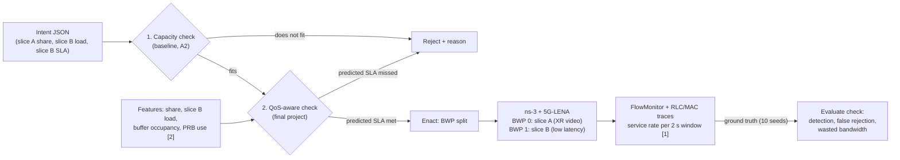

# A3: Literature Review

**Course:** Multimedia Wireless Networks (ET5907701), Fall 2026 · **Student:** Petrajoy Davidson (M11502803) · **Path:** Advanced · **Due:** 2026/11/17, 08:00 · **Presentation:** Week 11, 10 minutes

**One-line take-away:** three IEEE Transactions papers show how slices share radio resources in 5G-LENA and how to score a slice's QoS over time (Rana et al.), which RAN measurements reveal a slice in trouble (Polese et al.), and how far a "predict, then accept or reject" intent check has got (Habib et al.). They turn my A1 proposal into a concrete plan: sweep the slice share **and** the victim slice's load, score the victim with a windowed service rate, and judge my check on missed harmful intents, false rejections and wasted bandwidth.

## Table of Contents

1. [How I Chose the Papers](#1-how-i-chose-the-papers)
2. [Paper 1: QoS-Improving Downlink Scheduling for RAN Slicing (Rana et al., IEEE TVT 2024)](#2-paper-1-qos-improving-downlink-scheduling-for-ran-slicing-rana-et-al-ieee-tvt-2024)
3. [Paper 2: ColO-RAN, DRL xApps for Slicing (Polese et al., IEEE TMC 2023)](#3-paper-2-colo-ran-drl-xapps-for-slicing-polese-et-al-ieee-tmc-2023)
4. [Paper 3: Intent-Driven RAN Management With Intent Validation (Habib et al., IEEE TNSE 2026)](#4-paper-3-intent-driven-ran-management-with-intent-validation-habib-et-al-ieee-tnse-2026)
5. [Side by Side](#5-side-by-side)
6. [Revised Project Proposal](#6-revised-project-proposal)
   - [6.1 What changed and why](#61-what-changed-and-why)
   - [6.2 Revised research questions](#62-revised-research-questions)
   - [6.3 Revised system model](#63-revised-system-model)
   - [6.4 Revised scenarios](#64-revised-scenarios)
   - [6.5 Revised KPIs](#65-revised-kpis)
   - [6.6 Revised simulation settings](#66-revised-simulation-settings)
   - [6.7 Revised plan](#67-revised-plan)
7. [References](#7-references)

## 1. How I Chose the Papers

I used Keshav's three passes from A1 [4]. Pass 1 on about a dozen candidates from my thesis reading list and from searches on "RAN slicing ns-3", "5G-LENA slicing" and "intent validation RAN". I kept a paper only if it is in an **IEEE Transactions** journal and answers one piece of my project:

| Piece of my project | What I need from the literature | Paper kept |
| --- | --- | --- |
| The problem: how slices share resources and how a slice's QoS is scored | A RAN slicing study **in ns-3 / 5G-LENA** with per-slice QoS targets | [1] Rana et al., *IEEE Trans. Veh. Technol.* |
| The inputs of my check | Which per-slice RAN measurements show that a slice is short of resources; how slicing actions are described | [2] Polese et al. (ColO-RAN), *IEEE Trans. Mobile Comput.* |
| The check itself | A method that validates an intent by predicting its QoS impact **before** enactment, and how it was evaluated | [3] Habib et al., *IEEE Trans. Netw. Sci. Eng.* |

Dropped after pass 1: Pagin et al., "Enabling RAN slicing through carrier aggregation in mmWave cellular networks" (MedComNet 2020): an ns-3 slicing study with public code, but a conference paper. Adamczyk and Kliks (IEEE Commun. Mag. 2023), xApp conflict detection: close to my thesis, but a magazine paper about mobility xApps.

Pass 2 on the three kept papers, reading every figure's axes and every parameter table.

## 2. Paper 1: QoS-Improving Downlink Scheduling for RAN Slicing (Rana et al., IEEE TVT 2024)

M. K. Rana, T. Pecorella, B. Sardar, R. R. Thipparaju, D. Saha, "A QoS improving downlink scheduling scheme for slicing in 5G radio access network (RAN)," *IEEE Trans. Veh. Technol.*, vol. 73, no. 3, pp. 4219–4233, Mar. 2024, doi: 10.1109/TVT.2023.3327874. Open access (CC BY 4.0).

### 2.1 Problem, importance, challenges

| | |
| --- | --- |
| **Problem** | How to split the radio resources of a cell among slices with different QoS targets and priorities, every scheduling interval, so that each slice keeps its target QoS while the spectrum is used efficiently. |
| **Importance** | Static per-slice reservation protects each slice but wastes spectrum; fixed priorities starve low-priority slices or, the other way round, put a demanding application in a low-priority slice at risk. Slices are dynamic, so their share has to follow the load. |
| **Challenges** | delays outside the RAN (server → UPF) are random, so a scheduler that only budgets the UPF → UE delay misses the real deadline; existing slice schedulers are "sequential" (a lower-priority slice is served only after a higher one) and collapse under load; the optimal allocation is NP-hard (shown by reduction from subset sum). |

**Their solution:** every packet gets an expiry time from its end-to-end delay and inter-packet-delay budgets. The allocation is written as a chance-constrained problem (total demand may exceed the resource pool with probability ≤ p), turned into a deterministic 0/1 knapsack with the *effective bandwidth* of each packet's demand, and solved by LP relaxation in O(|U|). A priority vector δ per slice (Table IV) tunes how much each slice may get ahead of another; each slice's "transmission need" (the fewest packets to send now so that none expires later) is predicted from its traffic model.

### 2.2 System model

| Element | Description |
| --- | --- |
| Environment | Two-tier HetNet in a 2 km × 2 km area (Fig. 2): macro gNBs (43 dBm, 200 MHz, SCS 15 and 30 kHz, 3.7 GHz) overlaid with small cells (30 dBm, 200 MHz, SCS 60 kHz, 28 GHz), cell spacing 866 m, small-cell radius 250 m. 80 % of users indoor at 3 km/h, 20 % outdoor at 100 km/h. A UE can be served by more than one gNB; the RBs of all gNBs form one resource pool |
| Slices and traffic | Slice 1 MTC (TCP echo; 4-state semi-Markov source: OFF, periodic update, event-driven, payload exchange, mean rate W̄ from the given P, L, W); Slice 2 VoIP (modified Poisson arrivals, 12.65 kbit/s); Slice 3 video (H.265, 30 fps, 4K, 15 Mbit/s, Pareto inter-arrivals). VoIP and video flows last 120 s, MTC runs all the time |
| QoS targets (Sec. V-A) | end-to-end delay ≤ 100 ms for all; inter-packet delay ≤ 40 ms (VoIP, video), ≤ 1 ms (MTC); PLR ≤ 10⁻² (MTC, VoIP), ≤ 10⁻⁶ (video); throughput ≥ 20 kbit/s, 12.65 kbit/s, 15 Mbit/s |
| Delay model | end-to-end = d(server→UPF) + d(UPF→UE); server→UPF exponential with mean 20 ms, UPF→UE fixed 5 ms, plus ±5 ms per-packet variation |
| Inputs | per-slice load (number of flows), priority vector δ, delay offsets |
| Outputs | per-packet scheduling decision (which RBs, now or later) |
| Metrics | **goodput** = throughput × (1 − PLR), with expired packets counted as lost; **service rate of a flow** = share of 2 s averaging windows (3GPP default) in which the flow meets all its QoS targets; service rate of a slice = mean over its flows; maximum supported load (flows); spectral efficiency |

### 2.3 Experimental results

| Figure | X | Y | Main result |
| --- | --- | --- | --- |
| Fig. 3 | number of Monte Carlo samples N, 0–12 000 | spectral efficiency (bit/s/Hz), for small-cell traffic density 50–90 % | saturates beyond N ≈ 10⁴ at about 5–5.6 bit/s/Hz; higher density → higher efficiency. N = 10⁴ is used afterwards |
| Table IV | — | priority vector δ per target service rate | e.g. Scenario 1 (MTC > VoIP > video), targets 100 / 100 / [90, 100] %: δ = (28, 0.05, 1). If load exceeds capacity, the lowest-priority slice degrades first |
| Fig. 4 | number of Slice 1 flows, 0–160 000 | number of Slice 2 flows supported | trade-off line between the two slices' loads at full use; proposed (flexible δ) supports the most, then proposed (fixed), iRSS, FLS, CBAP |
| Fig. 5 | number of Slice 2 flows, 0–450 000 | number of Slice 3 flows supported, 0–400 | same ranking |
| Fig. 6 | mean end-to-end delay offset, 10–80 ms | service rate (%) | proposed 97 → 84.5 %; FLS 95 → 77.5 %; CBAP 94 → 76.5 % |
| Fig. 7 | inter-packet delay, 18–36 ms | service rate (%) | proposed 97 → 76.7 %; CBAP 91 → 58.6 %; FLS 90 → 56.5 % |
| Text | — | — | about 5.6 bit/s/Hz supported; "the QoS of a higher priority slice can never go down a pre-defined service rate, even when the load of a lower priority slice is increased" |

**What I read from it for my project:** Figs. 4–5 are exactly my problem drawn as a curve. When the cell is full, every flow added to one slice is paid for by the other slice. A slice-share intent picks a point on this curve, and whether that point is safe depends on the load of **both** slices. A2 showed the same thing on a small scale.

### 2.4 Settings needed to reproduce

| Parameter | Value in [1] | Stated? | My 5G-LENA setting for A4 |
| --- | --- | --- | --- |
| Simulator | 5G-LENA on ns-3 | version not stated | ns-3.48 + 5G-LENA v5.1 (A2 setup) |
| Topology | macro cells at 3.7 GHz overlaid with small cells at 28 GHz in 2 km × 2 km; Fig. 2 draws four sites 866 m apart and small cells of radius 250 m; exact number of gNBs not stated in the text | partly (figure) | same layout; I start with **one macro + one small cell** and scale up if run time allows |
| Bandwidth / SCS | 200 MHz; macro SCS 15 & 30 kHz (μ = 0, 1), small cell 60 kHz (μ = 2) | yes | same |
| Tx power | gNB 43 / 30 dBm, UE 23 / 16 dBm | yes | same |
| Duplex, MIMO | TDD, 2 × 2 | yes | TDD pattern **not stated** → `DL|S|UL|UL|DL|DL|S|UL|UL|DL` as in the 5G-LENA examples (my choice); 2 × 2 via the 5G-LENA MIMO model |
| Channel | "outdoor urban and indoor urban propagation loss model of ns-3" | vague | 3GPP TR 38.901 channel: UMa (macro), UMi-StreetCanyon (small cell), with outdoor-to-indoor penetration loss for indoor users (my choice) |
| CQI / MCS tables | TS 38.214 Tables 5.2.2.1-3 and 5.1.3.1-1/-2 | yes | 5G-LENA `McsTable` 2 (256-QAM) |
| Mobility | random way-point, 80 % indoor 3 km/h, 20 % outdoor 100 km/h | yes | `RandomWaypointMobilityModel` with those speeds |
| Traffic | MTC 4-state semi-Markov (S = 4, P, L̄ = [1, 0.5, 0.5, 0.5] s, W̄ = [0, 55, 50, 0] /s), TCP echo; VoIP 12.65 kbit/s; video H.265 4K 30 fps 15 Mbit/s, Pareto | partly (no packet sizes, no Pareto shape) | MTC as an `OnOff`-style state machine; VoIP as 12.65 kbit/s AMR-WB-like UDP; video with my A2 `XrVideoApp` at 30 fps, 15 Mbit/s |
| Core delay | server→UPF exponential, mean 20 ms; UPF→UE 5 ms; ±5 ms variation | yes | remote-host link with a random delay model |
| Schedulers compared | proposed, iRSS, FLS, CBAP | proposed: yes; others: "parameters from [10], [11]" | none of these ships with 5G-LENA → baseline = 5G-LENA's own `NrMacSchedulerOfdmaQos` and `OfdmaPF` |
| Warm-up | results after 1200 s | yes | — |
| Simulation length, number of UEs per slice, seeds, runs, confidence intervals | — | **not stated** | 10 seeds, 95 % CI |
| Code | — | **not released** | — |

**Reproduction gaps and doubts:** Figs. 4–5 count up to 160 000 and 450 000 flows, far beyond what a few gNBs with 200 MHz can carry at 12.65 kbit/s per VoIP flow; the paper does not explain the unit. Fig. 4 and Fig. 5 label the "flexible" and "fixed" curves the other way round, and Fig. 5 writes "CBAT". Table V uses four slices with URLLC first, which does not match the three slices of Table IV. No run count or confidence interval is reported. So in A4 I will reproduce the **scenario** (Fig. 2, Table III, the traffic and the service-rate metric) and the **trend of Fig. 6** (service rate falls as the server→UPF delay grows) with 5G-LENA's built-in schedulers, not the exact numbers of the proposed scheduler, whose code is not available.

## 3. Paper 2: ColO-RAN, DRL xApps for Slicing (Polese et al., IEEE TMC 2023)

M. Polese, L. Bonati, S. D'Oro, S. Basagni, T. Melodia, "ColO-RAN: Developing machine learning-based xApps for open RAN closed-loop control on programmable experimental platforms," *IEEE Trans. Mobile Comput.*, vol. 22, no. 10, pp. 5787–5800, Oct. 2023, doi: 10.1109/TMC.2022.3188013. Preprint: arXiv:2112.09559.

### 3.1 Problem, importance, challenges

| | |
| --- | --- |
| **Problem** | Build, train and test DRL xApps that control RAN slicing (PRBs per slice) and scheduling (scheduler per slice) through the O-RAN near-RT RIC, at scale and on real radios. |
| **Importance** | O-RAN promises data-driven closed-loop control, but there were no large datasets and no large test platforms, so ML control was rarely tried on a live RAN. |
| **Challenges named** | collecting datasets at scale; testing closed-loop ML without causing outages; unreliable inputs (missing or irregular KPM reports) and actions constrained by the standard; generalising to unseen deployments; choosing meaningful features. |

### 3.2 System model

| Element | Description |
| --- | --- |
| Environment | Colosseum emulator, RF scenario of downtown Rome (base station positions from OpenCelliD); 7 srsRAN-based base stations (SCOPE), 42 UEs, 3 slices (eMBB, MTC, URLLC), 2 UEs per slice per base station; near-RT RIC (OSC Bronze) over E2 |
| Inputs (actions) | **Slicing:** number of PRBs per slice, out of 50 (PRB masks in the scheduler). **Scheduling:** RR, waterfilling or PF per slice. The allocations the agent picks from include (eMBB, MTC, URLLC) = (36, 9, 5), (30, 9, 11), (30, 15, 5), (24, 21, 5), (24, 15, 11), (18, 15, 17), (18, 9, 23), (12, 15, 23), (6, 39, 5), (6, 9, 35) |
| Observations | From more than 30 KPMs, the agent uses downlink rate, buffer occupancy (or the ratio of PRBs granted to PRBs requested) and number of PHY transport blocks, 10 reports × 3 metrics compressed by an autoencoder |
| Rewards / metrics | eMBB: maximise throughput. MTC: maximise PHY TBs. URLLC: minimise buffer size (sched-slicing xApp) or maximise PRB ratio (sched xApp) |

### 3.3 Experimental results

| Figure | Result |
| --- | --- |
| Figs. 4–5 (correlation) | For eMBB with 36 PRBs, downlink MCS and buffer occupancy correlate at −0.56, TX symbols and TBs at 0.998. For URLLC with 11 PRBs the buffer drains quickly even at low MCS, and the MCS–buffer correlation drops to −0.2. Which KPM matters depends on the slice's load |
| Fig. 6 | Joint slicing + scheduling control beats per-slice scheduler choice on a fixed best slicing (36, 3, 11): better eMBB throughput below the 40th percentile and better URLLC PRB ratio |
| Fig. 7 | All DRL agents beat static baselines, even static baselines using the agent's most frequent allocation; the agent with a reduced action set starves URLLC; the autoencoder helps |
| Figs. 8–12 (online training) | Online training on the live RAN adapts the agent to a new traffic profile (+2 Mbit/s at the 80th percentile) but **degrades the users' throughput while it explores** (Figs. 10–11) |

### 3.4 Settings needed to reproduce

| Parameter | Value in [2] | ns-3 / 5G-LENA equivalent |
| --- | --- | --- |
| Radio | LTE (srsRAN), DL 0.98 GHz, UL 1.02 GHz, 10 MHz = 50 PRBs | NR numerology 0 (15 kHz), BWP of 50 PRBs at 0.98 GHz |
| Nodes | 7 BS, 42 UEs, 2 UEs/BS/slice | 7 gNBs on a site layout; same UE counts |
| Slicing | PRB masks, allocations summing to 50 PRBs | one BWP per slice sized to its PRBs (static, per run) |
| Schedulers | RR, waterfilling, PF | 5G-LENA RR, PF (no waterfilling) |
| Traffic | slice-based: eMBB 4 Mbit/s CBR per UE, MTC 44.6 kbit/s Poisson, URLLC 89.3 kbit/s Poisson; uniform: 1.5 Mbit/s per UE for all | `UdpClient` (CBR); Poisson via an `OnOff` source with exponential times |
| Channel | Colosseum emulated RF scenario (Rome) | **not reproducible**; closest is 3GPP UMa |
| Data | 3.4 GB, more than 73 h of traces | — |
| Run length, seeds | not stated per experiment | — |

ColO-RAN is a testbed paper: its numbers depend on SDR hardware and the emulated channel, so I use it for the **design** of my check (the form of slicing actions and which features to read), not as the A4 baseline.

## 4. Paper 3: Intent-Driven RAN Management With Intent Validation (Habib et al., IEEE TNSE 2026)

M. A. Habib, P. E. Iturria-Rivera, Y. Ozcan, M. Elsayed, M. Bavand, R. Gaigalas, M. Erol-Kantarci, "Harnessing the power of LLMs, informers and decision transformers for intent-driven RAN management in 6G," *IEEE Trans. Netw. Sci. Eng.*, vol. 13, pp. 4187–4206, 2026 (early access Aug. 2025), doi: 10.1109/TNSE.2025.3596028. Preprint: arXiv:2505.01841.

### 4.1 Problem, importance, challenges

| | |
| --- | --- |
| **Problem** | Take an operator intent in natural language, check that the network can honour it, then choose which RAN applications to run to meet it. Three parts: an LLM (QLoRA fine-tuned, with RAG) parses the intent; an **Informer** forecaster validates it; a hierarchical decision transformer (HDTGA) orchestrates applications such as traffic steering, cell sleeping and power control. |
| **Importance** | An intent can be well formed and still be harmful in the current state of the network, e.g. an energy-saving intent during peak traffic. |
| **Challenges named** | rule-based validation does not adapt to changing conditions; LLM parsing with few-shot prompts is not efficient; RL orchestration needs hand-made rewards and reacts only to the present state. |

### 4.2 System model

| Element | Description |
| --- | --- |
| Environment | Macro cell with dense small cells, NR–LTE dual connectivity, 60 users; NR at 3.5 GHz (64-element ULA) and 30 GHz (128-element UPA), SCS 15 / 60 kHz, 43 dBm; LTE 800 MHz, 40 MHz, 38 dBm; 3GPP CDL channel |
| Traffic | video (Pareto, 12.5 ms mean inter-arrival), gaming (uniform, 40 ms), voice (Poisson, 20 ms), URLLC (Poisson, 0.5 ms) |
| Inputs | intent type (throughput, delay, energy efficiency) and target value |
| Validation | Informer predicts **one step ahead** the cell traffic load, packet loss and power consumption; each prediction is compared with high/low thresholds (percentile-based); a lookup table maps (intent type, threshold state) to a "QoS drift"; drift > 0 → intent invalid; no matching entry → valid |
| Outputs | valid / invalid per intent; then the chosen RAN applications |
| Metrics | forecast MAE; validation accuracy; throughput, delay, energy efficiency of the orchestration |

### 4.3 Experimental results

| Result | Value |
| --- | --- |
| Forecast MAE of traffic load (Fig. 7) | Informer 16.1, GPT-2-style transformer 64.9, LSTM 70.5 |
| Intent validation (Fig. 9) | 12 of 100 intents wrongly validated → "88 % accuracy". The text calls the errors intents "accepted despite QoS drifts", but Fig. 9 shows red (incorrect) marks on both the drift and the no-drift rows. So the errors mix missed harmful intents and wrongly flagged safe ones, and **the paper never reports the two rates separately** (no confusion matrix) |
| Orchestration (Fig. 11) vs decision transformer / HRL with validation / HRL without | throughput +9.5 / +23.2 / +25.2 %; delay −30.4 / −53.5 / −61.5 %; energy efficiency +41.1 / +46.7 / +77.4 % |

### 4.4 Settings needed to reproduce, and what is missing

| Given | Missing |
| --- | --- |
| carriers, bandwidths (but Table III says 50 and 100 MHz while the text says 60 and 100 MHz), SCS, power, antennas, traffic types, Informer hyper-parameters (lr 10⁻⁴, batch 32, 4 encoder / 2 decoder layers, dropout 0.1) | simulator name; number of base stations; scheduler; mobility; simulation time; seeds; dataset size and split; threshold values; input window length |

Habib et al. cannot be reproduced in ns-3 from the paper. I use it as the **closest prior method** to my check and as a model of what I must evaluate better: they report one accuracy over 100 intents without separating missed harmful intents from wrongly rejected safe ones, and the drift labels come from the same simulation data and threshold rules that the validator uses, so the evaluation is not independent of the method.

## 5. Side by Side

| | [1] Rana et al. | [2] Polese et al. | [3] Habib et al. | My project |
| --- | --- | --- | --- | --- |
| Venue | IEEE TVT 2024 | IEEE TMC 2023 | IEEE TNSE 2026 | — |
| Slicing knob | per-packet RB allocation with slice priorities δ | PRBs per slice + scheduler | indirect (RAN apps) | bandwidth share per BWP, set by an intent |
| How a slice's QoS is judged | service rate over 2 s windows | throughput, buffer, PRB ratio | QoS drift of cell metrics | victim's p95 delay and loss → service rate (revised) |
| Platform | ns-3 + 5G-LENA | Colosseum (SDR) | not stated | ns-3 + 5G-LENA |
| Harm checked before enactment? | no (the scheduler adapts) | no (learns online, degrades users) | yes, by forecast + lookup | yes, by predicted victim KPIs |
| Seeds / runs reported | no | no | no | 10 seeds, 95 % CI |
| Reproducible in ns-3 | scenario and trends (A4) | partly (traffic, PRBs) | no | — |

**Gap my project fills:** [1] and [2] show that the share each slice gets decides its QoS, and that the safe share depends on every slice's load. But in both, the network itself picks the share; neither asks whether a share **requested from outside**, by an intent, is safe. [3] does ask, but with a cell-level forecast, without per-slice QoS targets, and with one accuracy number that does not separate misses from false rejections. My check predicts the **victim slice's** KPIs for a requested share and load before enactment, and is scored on misses, false rejections and wasted bandwidth.

## 6. Revised Project Proposal

> [!NOTE]
> Revision of [A1 §3](../A1-background/study-note.md#3-project-proposal) after A2 (my first runs) and the three papers above. Unchanged parts of A1 still hold.

### 6.1 What changed and why

| # | A1 proposal | Revised (A3) | Why | Source |
| --- | --- | --- | --- | --- |
| 1 | A4 baseline paper "to decide in A3" | **Rana et al. [1]**: rebuild their 5G-LENA scenario (Fig. 2, Table III, three traffic types, service rate) and reproduce the **trend of Fig. 6** with 5G-LENA's own QoS and PF schedulers | the only IEEE Transactions slicing study I found that runs on 5G-LENA, my simulator; their scheduler has no public code, so I reproduce scenario and trend, not the exact curve | [1] |
| 2 | Intent input = slice A's share only | Intent = **(slice A share, slice B load)**; the check reads slice B's offered load as well | A2: the same 90 / 10 split met the SLA with light slice B and broke it with heavy slice B. [1] Figs. 4–5: at full use, one slice's load is paid for by the other's. [2] Figs. 4–5: which KPM signals trouble depends on load | A2, [1], [2] |
| 3 | Share swept 50–90 % | Discrete catalogue of allocations, slice A share 50–95 % in 5 % steps, always the full carrier, like the PRB tuples of [2] | Every intent is a valid configuration that "fits"; only QoS can tell them apart | [2] |
| 4 | SLA satisfaction = share of runs (or flows) meeting all targets | **Service rate** = share of 2 s windows in which a flow meets all its targets, averaged over the slice's flows | a run-level average hides short outages; [1] uses the 3GPP 2 s averaging window, which is also how an SLA is checked in practice | [1] |
| 5 | Loss = (tx − rx) / tx | **Goodput** = throughput × (1 − PLR), with packets that miss their delay budget counted as lost; RLC Tx buffer bounded | A2: with an unbounded buffer, overload became a backlog still queued at the end of the run, which I wrongly counted as loss. [1] counts expired packets as lost, which is what the user sees | [1], A2 |
| 6 | End-to-end delay = whatever FlowMonitor reports | SLA delay is checked on the RAN part (UPF → UE, the 5QI packet delay budget); the core / server delay is set explicitly on the remote-host link and reported separately | [1]: the delay outside the RAN eats into the end-to-end budget and is random; mixing the two hides which part the intent affects | [1] |
| 7 | Check judged on detection and false rejection | Also on **bandwidth wasted by rejection** and resource utilisation of the accepted intents | A check that rejects everything risky leaves bandwidth idle; [1] makes the same argument against static reservation | [1] |
| 8 | Check inputs not specified | Predictor features: requested share, slice B offered load, slice B buffer occupancy and PRB use in the current configuration | [2]: buffer occupancy and granted/requested PRB ratio describe a slice's state with little redundancy | [2] |
| 9 | "Harmful" = misses an SLA target in simulation | Same, but ground truth comes from **separate seed-averaged runs**, never from the predictor's own rule; report the full confusion matrix | [3] reports a single accuracy (88 / 100) with misses and false rejections mixed, judged on labels from its own threshold rules | [3] |
| 10 | Predictor "lookup or nearest neighbour" | Two predictors: a threshold / lookup rule like [3] as the baseline, and a regression (k-NN) trained on simulated runs | compare against the closest prior method | [3] |
| 11 | Simulation time "to decide", ≥ 10 seeds | 22 s per run: 2 s warm-up discarded, then 10 windows of 2 s; 10 seeds per point, mean and 95 % CI | the service rate needs several windows per run; none of the three papers reports seeds or runs, so I commit to my own | [1], A1 |
| 12 | — | **Out of scope:** natural-language parsing (LLM), DRL control, new schedulers | [1], [2], [3] each need large models, datasets or a new scheduler; my contribution is the check, so intents enter as structured JSON (as in A2) and the schedulers are 5G-LENA's own | [1]–[3] |
| 13 | 2 slices | kept 2 slices (not 3 as in [1], [2]) | one aggressor and one victim make the harm measurable; a third slice adds combinations, not insight | [1], [2] |

### 6.2 Revised research questions

1. How does the victim slice's service rate (p95 delay and loss over 2 s windows) depend jointly on the share an intent gives the aggressor slice and on the victim's own load, and where is the SLA boundary in that plane?
2. Can a check that predicts the victim's KPIs before enactment reject harmful intents with a high detection rate, few false rejections and little wasted bandwidth, compared with a capacity-only check and with a threshold rule like [3]?

**Hypotheses:** (1) the SLA boundary is a curve in the (share, load) plane, like the load trade-off of [1] Figs. 4–5, so any check on the share alone either misses harmful intents or rejects safe ones; (2) a predictor that also uses the victim's load reaches a better detection / false-rejection trade-off than both baselines.

### 6.3 Revised system model

| Element | A1 | Revised |
| --- | --- | --- |
| Environment | 1 gNB, UEs on a grid | 1 gNB, static UEs for the project scenarios (isolates the intent's effect); A4 uses [1]'s HetNet with mobility |
| Inputs | slice share, UEs, load, distance | slice A share (catalogue), slice B load and UE count, core delay; slice A traffic fixed (3GPP XR video, A2) |
| Outputs | per-slice KPIs, SLA verdict, accept/reject | per-slice KPIs per 2 s window, service rate, goodput, resource utilisation, confusion matrix of the check |

### 6.4 Revised scenarios

| ID | Goal | Constants | Variables | Figure (X / Y / expected) |
| --- | --- | --- | --- | --- |
| A4 | Rebuild [1]'s scenario and Fig. 6 trend | [1]'s settings (§2.4), 5G-LENA QoS and PF schedulers | mean server→UPF delay 10–80 ms | X: delay; Y: service rate per slice; expected: falls with delay, as in [1] Fig. 6 |
| S1 | Map the SLA boundary | XR video slice A; 1 gNB | slice A share 50–95 %; slice B load 0.2–40 Mbit/s | heat map: X share, Y slice B load, colour = slice B service rate; contour = SLA boundary |
| S2 | Effect of victim UE count | share at the boundary from S1 | slice B UEs 2, 5, 10 | X: UEs; Y: service rate; expected: falls faster with more UEs |
| S3 | Evaluate the check | intent set from S1–S2 (train/test split by intent) | none / capacity-only / threshold rule [3] / predictor | X: intent; Y: slice B service rate after enactment |
| S4 | Price of the check | same as S3 | decision threshold | X: false rejection rate; Y: detection rate; marker size: wasted bandwidth |

### 6.5 Revised KPIs

A1's per-slice KPIs (throughput, mean and p95 delay, jitter, loss) and the check's KPIs (detection rate, false rejection rate, prediction error, decision time) stay. Changed or added:

| KPI | Definition | Source |
| --- | --- | --- |
| Service rate (replaces "SLA satisfaction") | share of 2 s windows in which a flow meets every target (p95 delay ≤ 10 ms, loss ≤ 1 %), averaged over the slice's flows | [1]; per-packet rx log binned by window |
| Goodput | throughput × (1 − PLR), PLR counting lost **and** expired (late) packets | [1] |
| Resource utilisation per BWP | used RBs / available RBs, from 5G-LENA MAC scheduling traces | [1], [2] |
| Slice B buffer occupancy | mean RLC Tx buffer of slice B bearers (predictor feature) | [2]; RLC buffer-status traces |
| Bandwidth wasted by rejection | share of the best safe intent − share of the intent finally enacted (aggressor side) | computed |

### 6.6 Revised simulation settings

| Parameter | A1 | Revised |
| --- | --- | --- |
| Simulator | ns-3 + 5G-LENA | ns-3.48 + 5G-LENA v5.1 (installed in A2) |
| Spectrum | 2 BWPs | 100 MHz at 28 GHz, μ = 2, split by the intent into 2 BWPs (A2) |
| Slice A traffic | video-like | 3GPP TR 38.838 XR video, 30 Mbit/s, 60 fps per UE (A2, verified) |
| Slice B traffic | CBR | UDP CBR, swept 0.2–40 Mbit/s total |
| Slice B SLA | 5QI targets | p95 delay ≤ 10 ms (5QI 80 packet delay budget), loss ≤ 1 %, per 2 s window |
| Core delay | not modelled | fixed 5 ms on the remote-host link, reported separately [1] |
| RLC | default (unbounded) | bounded Tx buffer; late packets counted as lost |
| Time | to decide | 22 s per run: 2 s warm-up + 10 windows of 2 s |
| Runs | ≥ 10 seeds | 10 seeds per point, mean and 95 % CI |

### 6.7 Revised plan

| Assignment | Deliverable |
| --- | --- |
| A3 (11/17) | this note: three IEEE Transactions papers, revised proposal |
| A4 (12/1) | [1]'s scenario in 5G-LENA (one macro + one small cell first), service rate vs server→UPF delay with 5G-LENA QoS and PF schedulers, 10 seeds, plotted against [1] Fig. 6; differences explained |
| Final (12/22) | S1–S4: SLA boundary map, then the QoS-aware check vs capacity-only and the threshold rule of [3] |

## 7. References

[1] M. K. Rana, T. Pecorella, B. Sardar, R. R. Thipparaju, and D. Saha, "A QoS improving downlink scheduling scheme for slicing in 5G radio access network (RAN)," *IEEE Trans. Veh. Technol.*, vol. 73, no. 3, pp. 4219–4233, Mar. 2024, doi: 10.1109/TVT.2023.3327874.

[2] M. Polese, L. Bonati, S. D'Oro, S. Basagni, and T. Melodia, "ColO-RAN: Developing machine learning-based xApps for open RAN closed-loop control on programmable experimental platforms," *IEEE Trans. Mobile Comput.*, vol. 22, no. 10, pp. 5787–5800, Oct. 2023, doi: 10.1109/TMC.2022.3188013.

[3] M. A. Habib, P. E. Iturria-Rivera, Y. Ozcan, M. Elsayed, M. Bavand, R. Gaigalas, and M. Erol-Kantarci, "Harnessing the power of LLMs, informers and decision transformers for intent-driven RAN management in 6G," *IEEE Trans. Netw. Sci. Eng.*, vol. 13, pp. 4187–4206, 2026, doi: 10.1109/TNSE.2025.3596028.

[4] S. Keshav, "How to read a paper," *ACM SIGCOMM Comput. Commun. Rev.*, vol. 37, no. 3, pp. 83–84, Jul. 2007.

[5] 3GPP, "System architecture for the 5G System (5GS); Stage 2," TS 23.501, Table 5.7.4-1.
