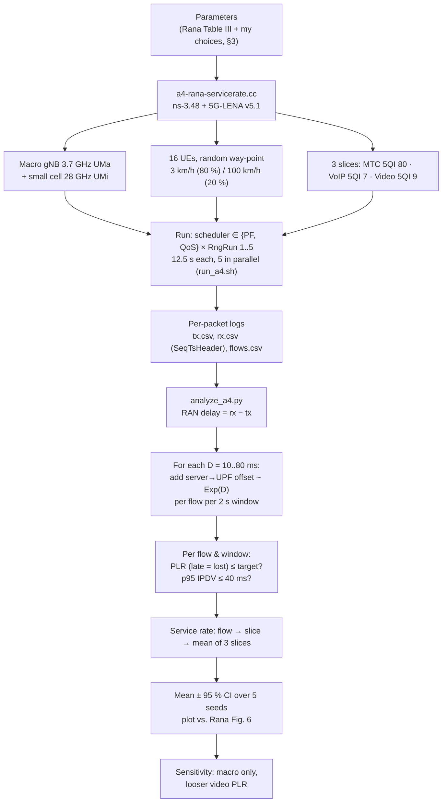
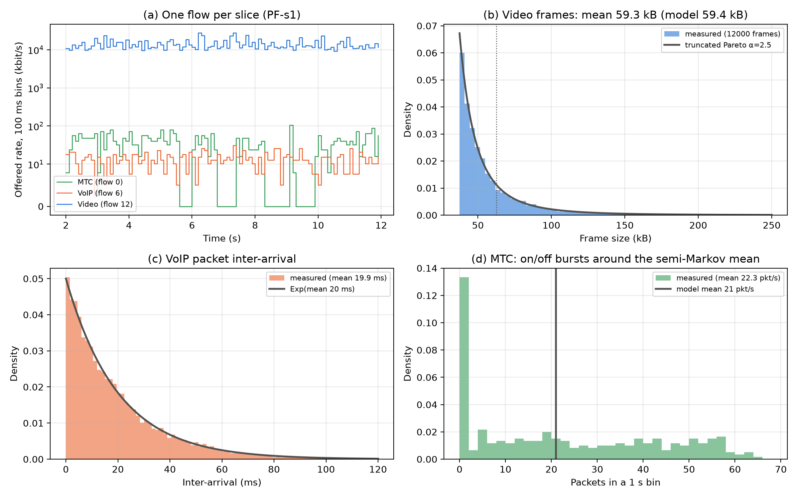
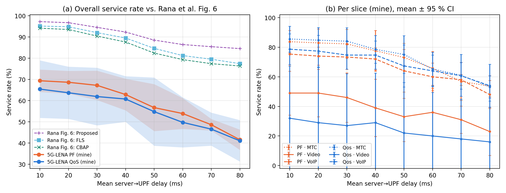

# A4: Baseline Reproduction

**Paper:** M. K. Rana, T. Pecorella, B. Sardar, R. R. Thipparaju, D. Saha, "A QoS improving downlink scheduling scheme for slicing in 5G radio access network (RAN)," *IEEE Trans. Veh. Technol.*, vol. 73, no. 3, pp. 4219–4233, Mar. 2024 (chosen in [A3 §6](../A3-literature-review/study-note.md#6-revised-project-proposal)).

**Result reproduced:** Fig. 6, service rate vs. mean end-to-end (server → UPF) delay, 10–80 ms.

**One-line take-away:** the **trend** of Fig. 6 reproduces with 5G-LENA's own schedulers (service rate falls as the server delay grows, faster beyond 40–50 ms), but my curves sit **25–30 points lower**. Most of the gap comes from UEs stuck on the 28 GHz small cell: Rana pools the resources of all gNBs and serves a UE from more than one, 5G-LENA attaches each UE to one gNB with no handover. On the macro cell alone the gap shrinks to about 14 points at 10 ms.

## Table of Contents

- [1. What I reproduce and why](#1-what-i-reproduce-and-why)
- [2. Flowchart](#2-flowchart)
- [3. Scenario and parameters](#3-scenario-and-parameters)
- [4. Method: from packets to service rate](#4-method-from-packets-to-service-rate)
- [5. Source code and how to repeat it](#5-source-code-and-how-to-repeat-it)
- [6. Numerical results](#6-numerical-results)
- [7. Why my curve differs from Fig. 6](#7-why-my-curve-differs-from-fig-6)
- [8. What broke on the way](#8-what-broke-on-the-way)
- [9. What this baseline means for the final project](#9-what-this-baseline-means-for-the-final-project)
- [10. References](#10-references)

## 1. What I reproduce and why

| | |
| --- | --- |
| Figure | Rana et al. Fig. 6: x = mean end-to-end delay offset (server → UPF), 10–80 ms; y = service rate (%) |
| Their curves | proposed scheduler 97.2 → 84.5 %, FLS 95.1 → 77.4 %, CBAP 94.1 → 76.3 % (read off the figure, [reference/rana_fig6.csv](reference/rana_fig6.csv)) |
| My curves | 5G-LENA's built-in `NrMacSchedulerOfdmaPF` and `NrMacSchedulerOfdmaQos` |
| Why this figure | it uses the paper's own metric (service rate per 2 s window), it isolates one variable, and the delay outside the RAN is exactly what my project's intent check must budget for |
| Why not the proposed scheduler | its code is not released, and FLS / CBAP are not in 5G-LENA. So I reproduce the **scenario, the metric and the trend**, with the schedulers I can run, and compare levels against FLS / CBAP as the closest "conventional" curves |

## 2. Flowchart



## 3. Scenario and parameters

| Parameter | Rana et al. | Mine | Why different |
| --- | --- | --- | --- |
| Simulator | 5G-LENA on ns-3, version not stated | ns-3.48 + 5G-LENA v5.1 (A2 install) | — |
| Topology | macro gNBs 866 m apart + small cells r = 250 m in 2 × 2 km; UE served by several gNBs, one resource pool | **1 macro + 1 small cell** on separate bands (no interference); each UE attached to one gNB, no handover | run time; 5G-LENA has no multi-gNB resource pool |
| Macro | 3.7 GHz, 43 dBm, 200 MHz, SCS 15/30 kHz | 3.7 GHz, UMa, 43 dBm, **100 MHz**, μ = 1 (30 kHz) | 200 MHz cost 170 s CPU per simulated second |
| Small cell | 28 GHz, 30 dBm, 200 MHz, SCS 60 kHz | 28 GHz, UMi-StreetCanyon, 30 dBm, **100 MHz**, μ = 2 (60 kHz) | same |
| UE area | 2 × 2 km | macro ± 300 m, small cell ± 110 m around the gNB | smoke test: ± 433 m / ± 250 m left edge UEs without usable SINR (§8) |
| TDD | stated, pattern not given | `DL\|S\|UL\|UL\|DL\|DL\|S\|UL\|UL\|DL` (5G-LENA examples) | not stated |
| Antennas | 2 × 2 MIMO | gNB 2 × 4 array, UE 1 × 2, single stream, ideal direct-path beamforming | 4 × 8 was too slow; MIMO not configured |
| Channel | "outdoor / indoor urban" | 3GPP TR 38.901, shadowing on, channel updated every 100 ms; no outdoor-to-indoor loss | vague in paper |
| Mobility | random way-point, 80 % indoor 3 km/h, 20 % outdoor 100 km/h | same speeds; fast UEs on the macro only, slow UEs alternate macro / small | no handover in 5G-LENA |
| UEs | not stated | MTC 6, VoIP 6, video 4 (macro 11, small 5) | 8 video UEs overloaded the macro (21–38 % video loss) |
| MTC (slice 1) | 4-state semi-Markov, L̄ = [1, .5, .5, .5] s, W̄ = [0, 55, 50, 0] /s, TCP echo | same L̄ and W̄, Poisson within a state, next state uniform among the other three, 100 B, **UDP** | P matrix and size not given; UDP so the server delay can be added afterwards (§4) |
| VoIP (slice 2) | 12.65 kbit/s, modified Poisson | Poisson, mean 20 ms, 32 B (12.8 kbit/s) | — |
| Video (slice 3) | H.265 4K 30 fps 15 Mbit/s, Pareto | 30 fps, Pareto frame sizes (shape 2.5, capped at 4 × 62.5 kB), 1400 B packets; **14.25 Mbit/s** after the cap | shape not given (details §3.1) |
| Priorities | Scenario 1: MTC > VoIP > video | 5QI 80 (P 68) > 5QI 7 (P 70) > 5QI 9 (P 90) | — |
| Schedulers | proposed, iRSS, FLS, CBAP | 5G-LENA OFDMA **PF** and **QoS** (QoS `FairnessIndex` = 0, §8) | no public code |
| Server → UPF delay | Exp, mean = x-axis; UPF → UE 5 ms ± 5 ms | Exp(D) added in post-processing, one value per flow per 2 s window; UPF → UE = simulated RAN delay | §4 |
| QoS targets | e2e ≤ 100 ms; IPD ≤ 40 ms (VoIP, video), 1 ms (MTC); PLR ≤ 1e-2 (MTC, VoIP), 1e-6 (video) | same, IPD read as p95 delay variation; MTC IPD not checked | §4 |
| Time | results after 1200 s | 12.5 s: 2 s warm-up + **5 windows of 2 s** + 0.5 s drain | run time |
| Seeds / runs | not stated | **RngRun 1–5** (RngSeed 1), **10 runs** (2 schedulers × 5 seeds), mean ± 95 % Student-t CI | — |

### 3.1 Traffic model per slice

All three sources are one ns-3 application, `SliceSourceApp` in [a4-rana-servicerate.cc](src/a4-rana-servicerate.cc), running on the remote host and sending downlink UDP to one UE each. Every packet carries a 12-byte `SeqTsHeader` (sequence number + tx time) so the receiver can match it to the tx log.

| | Slice 1: MTC | Slice 2: VoIP | Slice 3: Video |
| --- | --- | --- | --- |
| Rana et al. | 4-state semi-Markov (OFF, periodic update, event-driven, payload exchange), TCP echo; throughput ≥ 20 kbit/s | 12.65 kbit/s, modified Poisson; flows of 120 s | H.265 4K, 30 fps, 15 Mbit/s, Pareto; flows of 120 s |
| Arrival process (mine) | state *s* lasts Exp(L̄ₛ), L̄ = [1, 0.5, 0.5, 0.5] s; inside it, Poisson with rate W̄ₛ = [0, 55, 50, 0] pkt/s; next state uniform among the other three | Poisson, mean inter-arrival 20 ms | one frame every 1/30 s (fixed), cut into back-to-back packets |
| Packet / frame size | 100 B | 32 B | frame ~ Pareto, shape α = 2.5, scale = 0.6 × 62.5 kB, capped at 4 × 62.5 kB; packets ≤ 1400 B |
| Expected mean rate | 21 pkt/s → **16.8 kbit/s** (time share per state 40 / 20 / 20 / 20 %) | 50 pkt/s → **12.8 kbit/s** | **14.25 Mbit/s** (15 Mbit/s nominal; the cap trims the Pareto tail) |
| 5QI → priority | 80 (non-GBR low-latency eMBB) → 68, highest | 7 (voice / video / gaming) → 70 | 9 (video, TCP default) → 90, lowest |
| QoS targets (Rana Sec. V-A) | e2e ≤ 100 ms, PLR ≤ 1e-2 | e2e ≤ 100 ms, PLR ≤ 1e-2, IPD ≤ 40 ms | e2e ≤ 100 ms, PLR ≤ 1e-6, IPD ≤ 40 ms |
| UEs (macro / small) | 6 (4 / 2), 1 at 100 km/h | 6 (4 / 2), 1 at 100 km/h | 4 (3 / 1), 1 at 100 km/h |
| Start | random in the first 100 ms after 0.4 s, random first state | same | same |
| Not stated in the paper → my choice | packet size, transition matrix P | packet size (32 B = AMR-WB 12.65 kbit/s frame) | Pareto shape, cap, packet size |
| **Same as the paper?** | structure, L̄ and W̄ yes; **UDP downlink instead of TCP echo** (no ACKs or uplink replies); mean 16.8 kbit/s while Rana's target is ≥ 20 kbit/s, so their source may be heavier | rate yes; plain Poisson instead of the unexplained "modified Poisson"; always on instead of 120 s calls | 30 fps and Pareto family yes; **Pareto on the frame size at fixed 30 fps, Rana puts it on the inter-arrivals**; 14.25 instead of 15 Mbit/s; always on instead of 120 s flows |

Offered load per cell: macro ≈ 3 × 14.25 + 8 × ~15 kbit/s ≈ **43 Mbit/s**, small cell ≈ **14 Mbit/s**; video is > 99 % of the bytes.

**Verification from my runs** ([src/traffic_a4.py](src/traffic_a4.py), all 10 runs, 2–12 s, offered traffic before the RAN):

| Slice | Expected rate | Measured rate (mean ± sd over flows) | Expected pkt/s | Measured pkt/s | Packet size | Flows |
| --- | --- | --- | --- | --- | --- | --- |
| MTC | 16.8 kbit/s | 17.8 ± 7.0 kbit/s | 21 | 22.3 | 100 B | 60 |
| VoIP | 12.8 kbit/s | 12.8 ± 0.6 kbit/s | 50 | 50.1 | 32 B | 60 |
| Video | 14.25 Mbit/s | 14.23 ± 0.40 Mbit/s | 30 frames/s | 1285 | 1384 B (mean) | 40 |



*(a) One flow per slice: video steady around 10⁴ kbit/s, VoIP around 13 kbit/s, MTC switching between bursts and silence. (b) Video frame sizes follow the truncated Pareto (measured mean 59.3 kB, model 59.4 kB). (c) VoIP inter-arrivals follow Exp(20 ms) (measured mean 19.9 ms). (d) MTC packets per second: a peak at 0 (OFF and payload states, 60 % of the time) and a spread up to ~60 (the 55 and 50 pkt/s states), mean 22.3 vs. 21 pkt/s.*

MTC's large spread over flows (± 7 kbit/s) is expected: with mean state durations of 0.5–1 s, a 10 s window holds only about 15 state visits, so each flow's mean depends on which states it happened to visit.

## 4. Method: from packets to service rate

**One simulation serves all eight delay values.** All traffic is UDP, so the server → UPF delay does not change what the RAN does; it only adds to each packet's delay. I simulate the RAN once per (scheduler, seed), log every packet's RAN delay, and add the server delay in [analyze_a4.py](src/analyze_a4.py) for D = 10, 20, …, 80 ms. That is 10 runs instead of 80.

1. **RAN delay** of a packet = rx time − tx time (the SeqTsHeader carries the tx timestamp); never received = lost.
2. **Server offset** ~ Exp(D), drawn once per flow per 2 s window (the path delay of a flow changes slowly; drawing per packet would make the delay variation fail almost every window). Same random offsets for PF and QoS at a given (seed, D): a paired comparison.
3. **Lost** = not received **or** end-to-end delay > 100 ms (expired packets count as lost, as in the paper).
4. A flow **meets its QoS in a window** if PLR ≤ target **and** p95 inter-packet delay variation ≤ 40 ms (VoIP, video). MTC's 1 ms IPD target is below the gaps of an on/off source, so it is not checked. Windows in which a flow sent nothing (MTC OFF) are skipped.
5. **Service rate**: flow = share of its windows that meet the QoS; slice = mean over its flows; overall (y-axis) = mean of the three slices.

## 5. Source code and how to repeat it

| File | What it does |
| --- | --- |
| [src/a4-rana-servicerate.cc](src/a4-rana-servicerate.cc) | the ns-3 scenario: two cells, three slice sources (`SliceSourceApp`), per-packet tx / rx logs |
| [src/run_a4.sh](src/run_a4.sh) | copies the scenario into `scratch/`, builds it, runs schedulers × seeds in parallel, then the analysis |
| [src/analyze_a4.py](src/analyze_a4.py) | service rate per window, CI over seeds, plot against Fig. 6, sensitivity options `--cell`, `--video-plr` |
| [src/diag_run.py](src/diag_run.py) | per-UE / per-cell loss and RAN delay of one run (used to tune coverage and load) |
| [src/traffic_a4.py](src/traffic_a4.py) | checks the offered traffic of every run against the three source models (§3.1) |
| [reference/rana_fig6.csv](reference/rana_fig6.csv) | Fig. 6 values read off the paper |

Run on the lab VM (Ubuntu 22.04, 8 vCPU, shared with Kubernetes):

```bash
cd A4-baseline/src
bash run_a4.sh                    # build + 10 runs (5 in parallel) + analysis, ~20 min
# one run by hand:
~/ns-3-dev/build/scratch/ns3.48-a4-rana-servicerate-default --scheduler=PF --RngRun=1 --simTag=PF-s1 --outputDir=../results/raw
# sensitivity checks (analysis only):
python3 analyze_a4.py ../results/raw --out ../results/sens-macro --cell macro
python3 analyze_a4.py ../results/raw --out ../results/sens-vplr --video-plr 1e-2
```

Each run took about 8–10 min wall clock with 5 in parallel; the whole sweep took 20 min. Raw logs (38 MB) are not committed (`.gitignore`); everything else in [results/](results/) is.

## 6. Numerical results



*(a) Overall service rate, mine (solid, band = 95 % CI over 5 seeds) vs. Rana Fig. 6 (dashed). (b) Per slice.*

**Overall service rate (%)**, mean ± 95 % CI over 5 seeds ([results/fig6_table.md](results/fig6_table.md)):

| Delay (ms) | PF (mine) | QoS (mine) | Rana proposed | Rana FLS | Rana CBAP |
| --- | --- | --- | --- | --- | --- |
| 10 | 69.4 ± 5.3 | 65.4 ± 13.6 | 97.2 | 95.1 | 94.1 |
| 20 | 68.6 ± 5.4 | 63.7 ± 12.3 | 96.7 | 94.8 | 93.5 |
| 30 | 67.2 ± 6.9 | 61.9 ± 13.6 | 94.5 | 92.0 | 90.4 |
| 40 | 62.9 ± 7.5 | 60.7 ± 10.8 | 92.3 | 89.5 | 87.6 |
| 50 | 56.7 ± 11.1 | 54.8 ± 16.1 | 88.5 | 84.6 | 82.4 |
| 60 | 53.9 ± 7.3 | 49.7 ± 11.8 | 86.4 | 81.2 | 79.3 |
| 70 | 48.6 ± 2.7 | 46.6 ± 7.8 | 85.4 | 79.5 | 77.4 |
| 80 | 41.6 ± 4.8 | 41.1 ± 9.8 | 84.5 | 77.4 | 76.3 |

**Per slice (%)**, mean over 5 seeds ([results/service_rate.csv](results/service_rate.csv)):

| Scheduler | Slice | 10 ms | 40 ms | 80 ms |
| --- | --- | --- | --- | --- |
| PF | MTC | 83.7 | 77.6 | 53.7 |
| PF | VoIP | 75.3 | 72.0 | 48.0 |
| PF | Video | 49.0 | 39.0 | 23.0 |
| QoS | MTC | 85.6 | 78.6 | 53.2 |
| QoS | VoIP | 78.7 | 74.7 | 54.0 |
| QoS | Video | 32.0 | 29.0 | 16.0 |

**RAN part only** (no server delay), mean over 5 seeds ([results/ran_delay.csv](results/ran_delay.csv)):

| Scheduler | Slice | RAN loss | mean | p95 | p99 |
| --- | --- | --- | --- | --- | --- |
| PF | MTC | 0.7 % | 4.2 ms | 6.7 ms | 58 ms |
| PF | VoIP | 0.7 % | 4.1 ms | 6.8 ms | 65 ms |
| PF | Video | 2.8 % | 23.5 ms | 116 ms | 276 ms |
| QoS | MTC | 0.5 % | 4.0 ms | 6.7 ms | 49 ms |
| QoS | VoIP | 0.8 % | 4.6 ms | 7.1 ms | 76 ms |
| QoS | Video | 6.6 % | 49.5 ms | 254 ms | 455 ms |

**Where the QoS misses happen** (PF, D = 10 ms, share of windows meeting the QoS):

| Slice | Macro, 3 km/h | Macro, 100 km/h | Small cell, 3 km/h |
| --- | --- | --- | --- |
| MTC | 97 % | 92 % | 60 % |
| VoIP | 92 % | 84 % | 46 % |
| Video | 82 % | 28 % | 4 % |

**Sensitivity checks** (same runs, analysis only), overall service rate, PF / QoS:

| Variant | 10 ms | 40 ms | 80 ms |
| --- | --- | --- | --- |
| Baseline (all UEs, video PLR 1e-6) | 69.4 / 65.4 | 62.9 / 60.7 | 41.6 / 41.1 |
| Video PLR target 1e-2 | 69.7 / 65.4 | 63.2 / 60.7 | 41.9 / 41.7 |
| Macro UEs only | 83.2 / 78.0 | 74.4 / 71.9 | 51.9 / 50.4 |
| Macro only + video PLR 1e-2 | 83.7 / 78.0 | 74.8 / 71.9 | 52.4 / 51.2 |

## 7. Why my curve differs from Fig. 6

| # | Observation | Reason | Evidence |
| --- | --- | --- | --- |
| 1 | **Trend matches**: monotone fall, steeper beyond 40–50 ms | a larger server delay leaves less of the 100 ms budget for the RAN; above ~50 ms the exponential tail alone pushes many windows past the budget | §6 table; both papers show the knee around 40–50 ms |
| 2 | **Level 25–30 points lower** | **single-gNB attachment.** Small-cell UEs meet their QoS in only 4–60 % of windows; Rana serves a UE from several gNBs out of one resource pool, so a UE in a bad 28 GHz spot is rescued. 5G-LENA has no handover or multi-connectivity | per-cell table; macro-only raises the curve by ~14 points |
| 3 | Even on the macro, ~14 points below FLS / CBAP | **no deadline-aware scheduling.** Rana's proposed scheduler, FLS and CBAP all use packet deadlines; PF and QoS do not, so RAN tails (p99 50–75 ms for MTC / VoIP) eat the budget. Also: 100 instead of 200 MHz, no MIMO, 12.5 s runs instead of 1200 s warm-up | RAN table |
| 4 | Video is the weakest slice (16–49 %) | at D = 10 ms a video window loses on average 10 % (PF) / 21 % (QoS) of its packets (lost + late), far above any target; the fast video UE and the small-cell video UE fail almost always | looser video PLR changes < 1 point, so it is not the 1e-6 target |
| 5 | **QoS ≤ PF**, the opposite of what the names suggest | to avoid a 5G-LENA assert I set the QoS `FairnessIndex` α = 0 (§8). The weight becomes (100 − P) / avg throughput, which **ignores channel quality**: QoS spends RBs on edge UEs, and video RAN loss doubles (6.6 % vs 2.8 %). MTC / VoIP gain slightly from the priority | RAN table; per-slice table |
| 6 | My slope is steeper (−28 points vs. −13 to −19) | Rana's schedulers react to a packet's remaining budget, mine cannot; and Rana's exact delay model (per packet or per flow, the role of the ± 5 ms) is not fully specified, so my per-window offset is an assumption | §4 step 2 |
| 7 | Wide CIs, especially video | only 4 video UEs and 5 seeds; one UE's position decides a lot | CI column |

**Which differences would change with more effort:** #2 (more cells with the macro as fallback, or all UEs on the macro), #3 partly (200 MHz, 2 × 2 MIMO, longer runs), #7 (more seeds and UEs). **Which would not:** #3's scheduler gap needs a deadline-aware scheduler, which is beyond A4.

## 8. What broke on the way

| # | Problem | Cause | Fix |
| --- | --- | --- | --- |
| 1 | QoS runs aborted: `NS_ASSERT weight > 0` in `nr-mac-scheduler-ue-info-qos.h:179` | weight = (100 − P) · potTput^α / avgTput; a UE with CQI 0 (out of coverage, or a fast UE in a fade) has potTput = 0 → weight 0 | `ns3::NrMacSchedulerOfdmaQos::FairnessIndex` = 0 (`--qosAlpha`); side effect in §7 #5 |
| 2 | First smoke test: VoIP 10 % loss, video 30 % loss | small-cell UEs up to 350 m from a 30 dBm 28 GHz gNB (VoIP loss 13–43 % beyond 170 m); macro edge UEs up to 612 m could not carry 15 Mbit/s | UE boxes ± 110 m (small) and ± 300 m (macro), found with `diag_run.py` |
| 3 | 200 MHz, 4 × 8 gNB array, 28 UEs: 1018 s for 6 simulated seconds | 3GPP fast-fading cost grows with antennas × bandwidth × UE–gNB pairs | 100 MHz, 2 × 4 array, 16 UEs, 12.5 s runs: 8–10 min per run |
| 4 | Macro still overloaded with 8 video UEs (21–38 % video loss) | 5 video UEs × 15 Mbit/s on one macro | 4 video UEs |

## 9. What this baseline means for the final project

- **The server delay matters as much as the slice share.** At 80 ms mean delay, even a lightly loaded macro meets the QoS in only about half the windows. My QoS-aware intent check (A3 §6) must budget the delay outside the RAN, not only the PRB share.
- **Cell and mobility dominate.** The same slice configuration gives 97 % on a slow macro UE and 4–60 % on a small-cell UE. For the final project I keep the static single-gNB setup from A3 §6.4, so that the intent is the only variable.
- **This pipeline is my baseline:** per-packet logs → service rate per 2 s window → CI over seeds. S1–S4 of the final project reuse it with the slice share and slice-B load as the swept variables.

## 10. References

[1] M. K. Rana, T. Pecorella, B. Sardar, R. R. Thipparaju, and D. Saha, "A QoS improving downlink scheduling scheme for slicing in 5G radio access network (RAN)," *IEEE Trans. Veh. Technol.*, vol. 73, no. 3, pp. 4219–4233, Mar. 2024, doi: 10.1109/TVT.2023.3327874.

[2] 5G-LENA (CTTC), NR module for ns-3, v5.1, https://5g-lena.cttc.es/ — `NrMacSchedulerOfdmaPF`, `NrMacSchedulerOfdmaQos`.

[3] 3GPP TR 38.901, "Study on channel model for frequencies from 0.5 to 100 GHz."

[4] 3GPP TS 23.501, Table 5.7.4-1 (5QI to QoS characteristics mapping).
